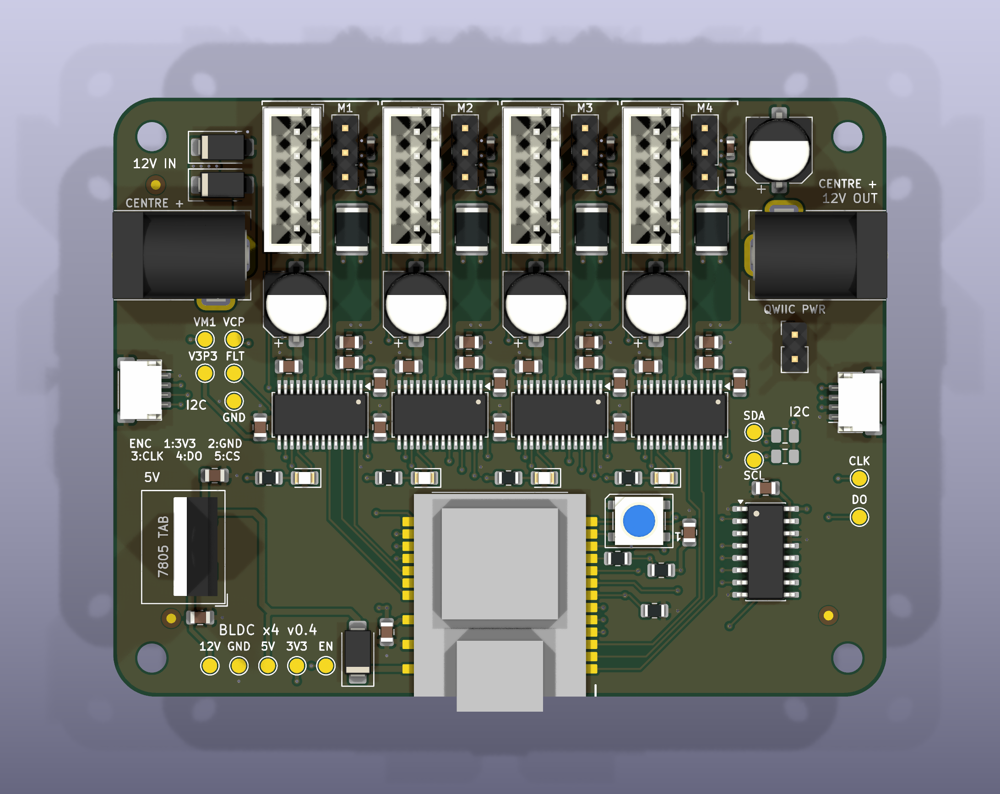

# ezbldc

A four-channel driver board for small gimbal-type brushless motors: a
Seeed XIAO ESP32-S3 Plus, four TI DRV8313 three-phase drivers, four encoder
ports, I2C in and out on Qwiic connectors, one 12 V supply. 80 × 62 mm,
four layers, designed in KiCad 10 for assembly at JLCPCB.

## Status

Revision **v0.4**. The design passes KiCad's electrical and design rule
checks, the board matches the schematic, and the design and fabrication
files have been through three review rounds. **No test results on real
hardware are recorded here yet: treat it as an unproven design.** The
things most likely to need attention are under [Things to know](#things-to-know).

## What is on it

- **Four motor channels.** Each is a DRV8313 wired as TI's reference
  circuit, with its own 1.1 A-hold polyfuse, 100 µF bulk capacitor and a
  red fault LED. Phase traces are 0.65 mm (about 1.7 A for a 10 °C rise).
  Motors plug onto plain 1 × 3, 2.54 mm headers.
- **Three PWM inputs per channel** from the XIAO (twelve in all, which is
  exactly what the ESP32-S3's two motor-control PWM units provide). There
  is no current sensing: the board is driven in voltage mode.
- **One shared enable line** on the drivers' reset pins, pulled low, so
  the outputs are off through boot, reset and flashing, and a low pulse
  clears a latched fault.
- **Four encoder ports** (JST-XH, 5 pin) beside the motor headers: a
  shared clock and data line and one chip select each, from a 74HC139.
- **I2C** on two Qwiic connectors (in and out). Pull-ups are not fitted.
- **Power**: 12 V on a 5.5 mm barrel jack (2.0 mm pin), centre positive,
  with a second jack wired straight through for the next board. Reverse-polarity
  diode, 15 V TVS clamp, and a 7805 making 5 V for the XIAO.
- A WS2812B status LED and fourteen test pads.

## Pin map

| Function | XIAO pad | GPIO |
|---|---|---|
| Motor 1 IN1 / IN2 / IN3 | D9 / D17 / D10 | 8 / 13 / 9 |
| Motor 2 IN1 / IN2 / IN3 | D19 / D8 / D18 | 11 / 7 / 12 |
| Motor 3 IN1 / IN2 / IN3 | D12 / D2 / D13 | 39 / 3 / 40 |
| Motor 4 IN1 / IN2 / IN3 | D0 / D11 / D1 | 1 / 38 / 2 |
| Driver enable (high = on) | D3 | 4 |
| Encoder clock | D14 | 41 |
| Encoder data | D15 | 42 |
| Encoder select A0 / A1 | D6 / D7 | 43 / 44 |
| Status LED data | D16 | 10 |
| I2C SDA / SCL | D4 / D5 | 5 / 6 |

D11–D19 are the XIAO Plus's extra pads, the small ones between its
fourteen main edge pads. `kicad/design_spec.py` is the authority for this
table.

## Connectors

- **Motor headers J11–J14**: pin 1 (phase 1) is the one nearest the
  middle of the board, pin 3 is at the board edge.
- **Encoder sockets J21–J24**: pin 1 is at the board edge.
  1 = 3V3, 2 = GND, 3 = clock, 4 = data, 5 = chip select (active low).
  Select lines A1 A0 = 00, 01, 10, 11 pick encoder 1, 2, 3, 4. One select
  is always low.
- **Qwiic J3 (in), J4 (out)**: 1 = GND, 2 = 3V3, 3 = SDA, 4 = SCL. The 3V3
  wire only passes from one connector to the other; closing jumper JP1
  joins it to the board's own 3.3 V.
- **J1 / J2**: 12 V in and out, centre positive.

The board itself carries no part designators (it is too dense).
[`kicad/output/assembly_top.pdf`](kicad/output/assembly_top.pdf) is the map
of which part is where.

## Encoder options

The port was designed for MagnTek MT6701 encoders read over SSI. What it
supports:

- **No encoder**: run a channel open loop.
- **One MT6701 on SSI**: fine, in any socket.
- **Several MT6701 on SSI: unproven.** With its chip select high an
  MT6701 becomes an I2C slave on the same clock and data pins, and its
  datasheet does not say the data pin is released. It may well work at an
  SSI clock of about 1 MHz or less; it has not been tested. If it does
  not, a tri-state buffer in the data line at each encoder, enabled by
  that encoder's chip select, fixes it without changing this board.
- **Other SPI-type encoders**: any part whose data output goes
  high-impedance while its chip select is high, and which can be read
  without a MOSI line (the port has none).
- **I2C encoders on the same two pins**, as a firmware choice: data is
  SDA (it has a 10 k pull-up and 100 Ω in series), clock is SCL. The
  clock line has **no pull-up on this board**, so the encoder boards must
  bring one. Leave pin 5 unwired. The encoders need distinct addresses.

## Things to know

- **Sustained current.** The input diode D1 is the warmest part of the
  supply path. About 3 A for the whole board is the comfortable sustained
  figure; the jacks are rated 5 A.
- **7805 heat.** About 0.7 W with the XIAO's radio off, about 1.25 W with
  WiFi on, which wants a heatsink. A K7805-500R3 switching module fits
  the same three holes. The silkscreen shows which side the tab goes:
  fitted backwards, the regulator puts about 11 V on the XIAO's 5 V pin.
- **The XIAO is soldered on by hand**, flat on its pads. JLCPCB do not
  stock it.
- **The status LED runs from 3.3 V**, below that part's rated 3.5 V.
- **Fault outputs light LEDs only.** The microcontroller cannot read
  them: all its pins are used.
- **Ten logic nets are autorouted.** They pass the rule checks but are
  not tidy. Power, the motor phases, the buses and the I2C lines are
  routed by hand (in `kicad/tools/build_board.py`).
- SDA, SCL and the Qwiic 3V3 wire cross the board on inner layer 2,
  through the 3.3 V plane.

## What is in this repository

| Path | What |
|---|---|
| `kicad/bldc_driver_board.kicad_pro` | The KiCad 10 project: two-page schematic and the routed board |
| `kicad/lib/` | The custom symbols and footprints (XIAO Plus, barrel jack, regulator) and their generators |
| `kicad/output/schematic.pdf` | The schematic |
| `kicad/output/assembly_top.pdf` | Part positions, with pin 1 marked |
| `kicad/output/signal_map.png` | The copper, coloured by kind of signal |
| `kicad/output/bldc_driver_board.step` | 3D model |
| `kicad/output/fab/` | Gerbers and drill files (zipped and loose), JLCPCB placement file and BOMs |
| `BOM.md`, `bom_jlcpcb.csv` | Parts with LCSC numbers, and an assembly cost estimate |
| `kicad/design_spec.py` | Every part and net, as data. The schematic and board are generated from it |
| `kicad/gen_schematic.py`, `kicad/tools/` | The generators (see below) |

## Ordering from JLCPCB

1. Upload `kicad/output/fab/bldc_driver_board_gerbers.zip`. It should be
   detected as 4 layers, 80 × 62.05 mm. Inner layer 1 is the solid ground
   plane.
2. Choose a lead-free HASL or ENIG finish rather than the default OSP:
   the XIAO and any hand-fitted parts are soldered after the board has
   been through the oven. State the layer order in the remark field:
   F_Cu, In1_Cu (`.g1`), In2_Cu (`.g2`), B_Cu.
3. Assembly: top side. Upload `bom_jlcpcb.csv` (or
   `bom_jlcpcb_smd_only.csv` to fit the through-hole parts yourself) and
   `cpl_jlcpcb.csv`.
4. **Check the placement preview** against `assembly_top.pdf` before
   paying: the + of the five round capacitors, pin 1 of the five ICs, the
   cathode stripe of the three diodes and four fault LEDs, the status LED,
   and that the Qwiic sockets face outward. The rotations in the
   placement file were worked out part by part from JLCPCB's own
   footprints, but their preview is the final word.

## Regenerating the design

The schematic and the board are generated, not drawn:

- `python3 kicad/gen_schematic.py` writes the schematic from
  `design_spec.py` (`check` runs ERC and compares the netlist with the
  spec; `export` writes the PDF).
- `kicad/tools/build_board.py`, run with KiCad's own Python, builds the
  board: placement, all hand-designed copper, planes, silkscreen.
- `kicad/tools/autoroute.py` has Freerouting place the remaining logic
  nets and runs the design rule check.
- `kicad/tools/export_outputs.py` rewrites everything in `kicad/output/`.

**`build_board.py` and `autoroute.py` overwrite the board file.** Anything
edited by hand in KiCad is lost if they are run again, and the autorouter
gives a different result each time.

They were written for KiCad 10 on macOS and have paths to match. The
autorouter step also needs Freerouting 2.1.0 (Java 21) and, for the
Specctra export and import, a local install of the KiCad MCP server that
`kicad/tools/kicad_cmd.py` calls; adapt that file to your own setup.
`export_outputs.py` needs `rsvg-convert`.

A few comments and schematic notes mention a "Node" board and a
"Central". These are other boards in the system this one was built for:
an earlier I2C peripheral board whose outline, mounting holes and
connector positions this board copies, and the I2C bus controller.
